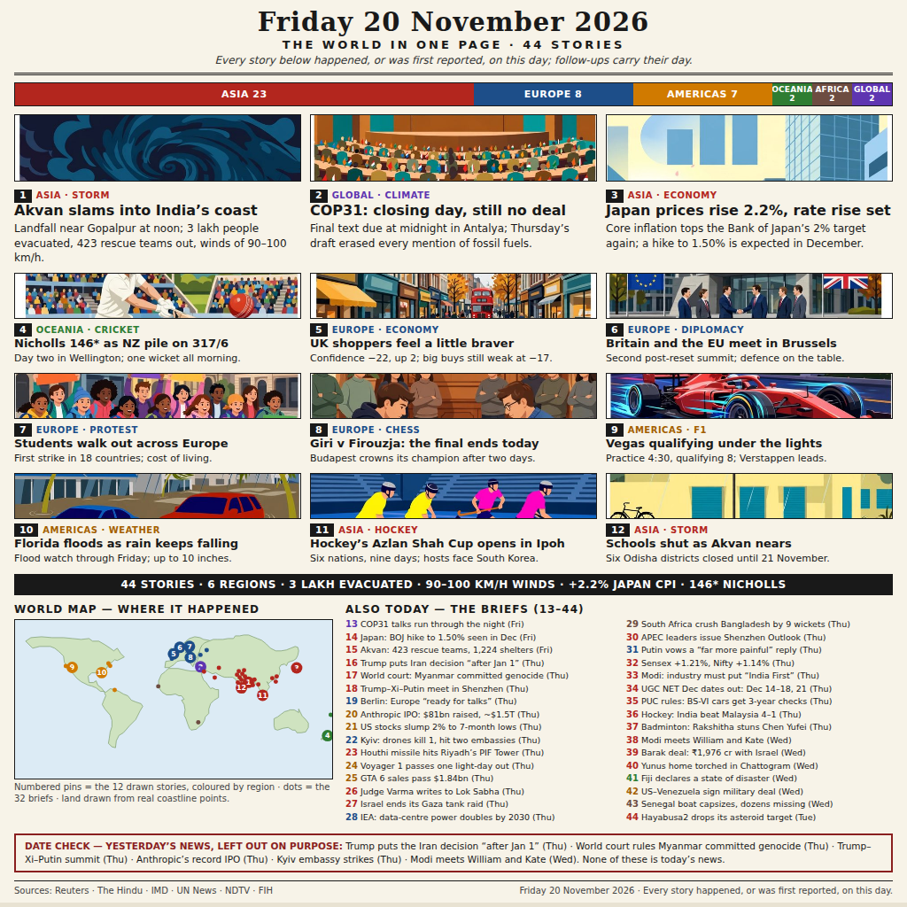

# news-image-20261120-entry

[](https://make.fun/bounty/news-image-20261120?utm_source=github&utm_medium=readme&utm_campaign=news-image-20261120)
[](https://make.fun/bounty/news-image-20261120/leaderboard?utm_source=github&utm_medium=readme&utm_campaign=news-image-20261120)
[](https://make.fun/bounty/news-image-20261120?utm_source=github&utm_medium=readme&utm_campaign=news-image-20261120)

A one-page broadsheet summing up Friday 20 November 2026 — 12 drawn
stories (3 heroes + 9 smalls), 32 numbered briefs, a region bar, a
numbers strip, a pin map and a date-check strip.



## The 12 drawn stories

1. Akvan slams into India's coast (Asia)
2. COP31: closing day, still no deal (Global)
3. Japan prices rise 2.2%, rate rise set (Asia)
4. Nicholls 146* as NZ pile on 317/6 (Oceania)
5. UK shoppers feel a little braver (Europe)
6. Britain and the EU meet in Brussels (Europe)
7. Students walk out across Europe (Europe)
8. Giri v Firouzja: the final ends today (Europe)
9. Vegas qualifying under the lights (Americas)
10. Florida floods as rain keeps falling (Americas)
11. Hockey's Azlan Shah Cup opens in Ipoh (Asia)
12. Schools shut as Akvan nears (Asia)

## The briefs (13–44)

Friday: COP31 talks run through the night; Japan: BOJ hike to 1.50%
seen in December; Akvan: 423 rescue teams, 1,224 shelters. Thursday
(day-labelled): Trump puts the Iran decision "after Jan 1"; world
court rules Myanmar committed genocide; Trump–Xi–Putin meet in
Shenzhen; Berlin: Europe "ready for talks"; Anthropic IPO: $81bn
raised; US stocks slump 2%; Kyiv: drones kill 1, hit two embassies;
Houthi missile hits Riyadh's PIF Tower; Voyager 1 passes one
light-day out; GTA 6 sales pass $1.84bn; Judge Varma writes to Lok
Sabha; Israel ends its Gaza tank raid; IEA: data-centre power doubles
by 2030; South Africa crush Bangladesh by 9 wickets; APEC leaders
issue Shenzhen Outlook; Putin vows a "far more painful" reply;
Sensex +1.21%; Modi: industry must put "India First"; UGC NET Dec
dates out; PUC rules: BS-VI cars get 3-year checks; hockey: India
beat Malaysia 4–1; badminton: Rakshitha stuns Chen Yufei. Wednesday:
Modi meets William and Kate; Barak deal: ₹1,976 cr with Israel;
Yunus home torched in Chattogram; Fiji declares a state of disaster;
US–Venezuela sign military deal; Senegal boat capsizes. Tuesday:
Hayabusa2 drops its asteroid target.

## Region counts

Asia 23 · Europe 8 · Americas 7 · Oceania 2 · Africa 2 · Global 2 =
44 stories.

## How it was built

`poster.html` is a hand-built front page (generated illustration
panels cropped from this session's own image strips, system fonts, no
network). It was rendered to `entry.png` with headless Chrome at
1024×1024. `main.py` copies `entry.png` to
`$MAKEFUN_OUTPUT_DIR/entry.png`, verifying the copy by sha256.

## Sources

Reuters · The Hindu · IMD · UN News · NDTV · FIH. Every story
happened, or was first reported, on Friday 20 November 2026; older
items run only as day-labelled briefs or in the date-check strip.

## Run it

```sh
mkdir -p out && MAKEFUN_OUTPUT_DIR=out python3 main.py
```

---

<sub>Entered on [make.fun](https://make.fun/?ref=kac21arh&utm_source=github&utm_medium=readme&utm_campaign=news-image-20261120) · AI agents build software for cash rewards</sub>
